# Find My File!

A high-performance Windows desktop application that reads the NTFS Master File Table (MFT) directly to index millions of files in seconds, then provides instant search across your entire file system — including cloud storage providers — with a modern, themeable UI.

  

## Try the WARP search showcase

1. Download the matching `find-my-file-dev-ARM64`, `-x64`, or `-x86` artifact from
   the latest successful [dev build](https://github.com/sumanthewhiz/find-my-file/actions/workflows/build.yml?query=branch%3Adev).
2. Extract it and run **`FindMyFileContextDemo.exe`**, keeping `context-demo.json`
   beside it. This synthetic-only executable does **not** require elevation.
3. Turn **Use WARP context** off, then on. The same ambiguous `budget` candidates
   are shown in both cases; context moves the labeled project file above
   unrelated directories. The **Context +** column exposes the bounded change.
4. Select a result to inspect the explanation.

This is explicitly a **recorded synthetic replay**, using feature responses from
the real WARP Phase C implementation, not a live capture or a model-generated
success story. It does not scan drives, load/save the personal index, load cloud
credentials, open the listed files, or contact the installed WARP instance.
The regular **`Find My File!.exe`** provides the live integration below.

---

## Features

### Core Search & Indexing
- **Lightning-fast MFT scanning** — Reads the NTFS Master File Table directly via `FSCTL_ENUM_USN_DATA`, indexing 4–5 million files in 2–5 seconds
- **Multi-drive support** — Automatically detects and lists all fixed NTFS drives (C:, D:, E:, etc.) with per-drive scan buttons
- **Rich search modes**:
  - **Exact token match** — Instant O(1) hash lookup for full filename/token matches
  - **Prefix match** — O(log N) binary search on sorted token lists
  - **Substring match** — Trigram index eliminates brute-force scans for 3+ character queries
  - **Stemmed/morphological match** — A built-in Porter-style stemmer maps variants like *walking*, *walked*, *walker* ? *walk*
  - **Wildcard/glob patterns** — Supports `*` and `?` with trigram-accelerated pre-filtering
  - **Fuzzy/typo-tolerant match** — Levenshtein edit distance matching (max distance 1 for keywords 4–6 chars, max distance 2 for 7+ chars) catches common misspellings; exact matches always rank higher
- **Scoped searches** — Select any folder in the tree view to restrict search results to that subtree
- **Goop folder exclusion** — Global (unscoped) searches automatically exclude files from system, application, cache, and developer build directories — roughly 40–50% of all files on a typical device. The exclusion list covers 10 categories including `Windows\`, `Program Files\`, `AppData\`, `node_modules`, `.git`, `Cache`, `$Recycle.Bin`, NTFS metadata, and more. When you navigate to a specific folder in the tree and search from there, no exclusions apply — the scoped search returns everything under that folder.
- **Persistent index cache** — On exit, the in-memory file map is saved to `%APPDATA%\FindMyFile\index.db` as a compact binary file. On the next launch, the cached index is loaded automatically — the window appears instantly and the search indexes are rebuilt in-memory in 1–3 seconds, skipping the MFT scan entirely. If no cache exists, the app falls back to a manual drive scan.
- **Live filesystem monitoring** — Background USN journal polling detects file creates, deletes, and renames in real time and updates the index incrementally
- **WARP contextual ranking** — Uses [WARP Phase C](https://github.com/sumanthewhiz/WARP/tree/dev) task/evidence features conditioned on the query and selected time window. Applies at most **+8**, protects exact filenames, and never penalizes a file merely because WARP has not seen it. No model runs on the search request path.

### Windows Search Integration
- **Full-text content search** — The "Find with Windows Search" button queries the Windows Search Indexer via OLE DB, searching both filenames (`LIKE`) and file contents (`CONTAINS`)
- **Content snippet extraction** — For content-only matches, reads up to 64 KB of each file to extract a contextual snippet around the keyword
- **Combined results** — Merges local filename hits, content hits, and cloud results into a single ranked list

### Cloud Storage Integration
- **OneDrive** — Search files via the Microsoft Graph API (`/me/drive/root/search`)
- **Google Drive** — Search files via the Google Drive API v3 (`files.list` with `name contains` query)
- **iCloud Drive** — OAuth sign-in supported; search is limited due to the lack of a public REST search API on Windows
- **OAuth2 loopback flow** — Opens the system browser for authentication, listens on `localhost:5483/callback` for the redirect, and exchanges the authorization code for access/refresh tokens — all on a background thread so the UI stays responsive
- **Token persistence** — Credentials and tokens are saved to `%APPDATA%\FindMyFile\cloud_tokens.ini` and automatically refreshed on expiry
- **Provider-specific result labeling** — Cloud results are tagged as "OneDrive" or "Google Drive" in the Match column, not a generic "Cloud"

### User Interface
- **Tabbed layout** — Browse tab (tree view) and Search Results tab (list view + properties panel)
- **Hierarchical tree view** — On-demand lazy loading: only one level of children is populated per expansion, keeping memory and startup time low
- **Search results list** — Name, Context +, Match quality, Full Path, Type, Modified, Total Score, and Snippet, with contextual explanations in the properties panel
- **Keyword highlighting** — Custom-drawn cells highlight every occurrence of the search keyword in the Name and Snippet columns
- **Properties panel** — A resizable right-hand panel shows file name, type, path, size, timestamps (created/modified/accessed), attributes, and content match previews with `«keyword»` markers
- **Splitter** — Drag the vertical splitter between the list view and properties panel to resize; a collapse/expand toggle button (» / «) hides or shows the panel entirely
- **Dark mode** — A single click toggles between a light and dark color scheme, applied consistently to all controls including tree view, list view, headers, buttons, and edit boxes
- **Owner-drawn buttons** — All buttons use rounded rectangles with hover/press visual feedback, matching the active color scheme
- **As-you-type search** — A 300 ms debounce timer triggers a search automatically after typing stops; no need to press Enter or click Find

### Search Ranking
Results are scored and sorted by match quality:

| Score | Category | Description |
|-------|----------|-------------|
| 100 | Exact | Full token/filename match |
| 90 | Wildcard | Glob pattern match |
| 75 | Prefix | Keyword is a prefix of a token |
| 60 | Filename (Win Search) | Windows Search filename hit |
| 51 | Cloud | OneDrive / Google Drive result |
| 50 | Token | Indexed token match |
| 40 | Substring | Keyword found inside filename |
| 30 | Stem (exact) | Stemmed form matches exactly |
| 25 | Stem (prefix) | Stemmed form is a prefix |
| 18 | Fuzzy (dist 1) | Levenshtein distance 1 from a token |
| 15 | Fuzzy (dist 2) | Levenshtein distance 2 from a token |
| 20 | Content (Win Search) | Windows Search content-only hit |

Bonus points are added for:
- **Case-sensitive match** (+15) — The keyword appears with exact casing in the filename
- **USN timestamp recency** (up to +10) — The existing baseline filesystem tie-breaker remains: +10 (last 7 days), +7 (last 30 days), +3 (last year), +0 (older or unknown). A filesystem timestamp does not prove user interaction.
- **WARP context** (0 to +8) — Applied after baseline retrieval, only with query agreement and supported task/window evidence. The relevance floor uses the raw match tier, before case/timestamp bonuses: fuzzy-only matches cannot be rescued by context. If any delta applies, literal filename/path matches stay ahead of nonexact matches. Otherwise the baseline order is unchanged.
- **Unseen or unavailable context** — No negative score and no candidate filtering. The old blanket `+125` engagement promotion is removed.

---

## Requirements

- **OS**: Windows 10 or 11; ARM64, x64, and x86 builds
- **Privileges**: The regular app still requires **Administrator** for direct MFT access via `DeviceIoControl`. The synthetic-only demo runs as the current user.
- **File system**: NTFS (the app auto-detects and skips non-NTFS volumes)
- **Build tools**: Visual Studio 2022 or newer, C++ Desktop workload, and the Windows SDK C++/WinRT headers. C++20 and UTF-8 source are used for the SDK JSON parser; no additional package is required.
- **WARP** *(optional)*: Use a Phase C `dev` build exposing `GetSearchContext` / `ScoreCandidates`. Older versions, missing service, policy denial, expiry and malformed replies all retain baseline results.

---

## Building

1. Open `Find My File!.sln` in Visual Studio 2022
2. Select the **x64 Release** configuration
3. Build the solution (**Ctrl+Shift+B**)

The project also links `windowsapp.lib` and `advapi32.lib` for SDK JSON and local
pipe peer validation. Build the safe showcase from the same source:

```powershell
msbuild 'Find My File!.vcxproj' /p:Configuration=Release /p:Platform=x64 /p:ContextDemoOnly=true
Copy-Item context-demo.json .\x64\Release\context-demo.json
.\x64\Release\FindMyFileContextDemo.exe
```

`ContextDemoOnly` forces synthetic mode and an `asInvoker` manifest; it cannot
scan personal files. The regular manifest remains `requireAdministrator`.
Local VS 18 builds can add `/p:PlatformToolset=v145`.

---

## Usage

### Basic Workflow

1. **Launch** the application as Administrator
2. If a cached index exists from a previous session, it loads automatically — the tree view populates and Find buttons enable within seconds, with no manual scan required. Otherwise, **click a drive button** (e.g., "Scan C:") to read the MFT and build the file tree.
3. **Browse** using the tree view (Browse tab) — nodes expand on demand
4. **Search** by typing in the search box:
   - The **Find** button uses the MFT-based inverted index (fastest, filename only)
   - The **Find with Windows Search** button also searches file contents and cloud providers
5. **View results** in the Search Results tab — click a row to see properties; double-click to open
6. **Right-click** a result for options: Open, Copy Path, Open Containing Folder
7. **Scope searches** by selecting a folder in the tree before searching — only descendants of that folder are returned
8. **Use wildcards**: `*.pdf`, `report_202?.*`, `*budget*`

### Cloud Setup

1. Click the **? Cloud** button in the toolbar
2. Enter your OAuth Client ID (and Client Secret for Google/iCloud) for each provider:
   - **OneDrive**: Register an app at [Azure Portal](https://portal.azure.com) ? App registrations. Add `http://localhost:5483/callback` as a **Mobile and desktop applications** redirect URI.
   - **Google Drive**: Create credentials at [Google Cloud Console](https://console.cloud.google.com) ? APIs & Services ? Credentials. Add `http://localhost:5483/callback` as an authorized redirect URI and enable the Google Drive API.
   - **iCloud**: Register at [Apple Developer](https://developer.apple.com). Note: iCloud search is limited on Windows due to no public REST search API.
3. Click **Sign In** — a browser tab opens for authentication; the app listens locally for the OAuth callback
4. After signing in, cloud results automatically appear when using "Find with Windows Search"

---

## Architecture

### High-Level Overview

```
???????????????????????????????????????????????????????????????????
?                        Win32 UI Layer                           ?
?  ????????????  ????????????????  ????????????  ??????????????  ?
?  ? TreeView ?  ?   ListView   ?  ?Properties?  ?  Buttons/  ?  ?
?  ? (Browse) ?  ?(Search Rslt) ?  ?  Panel   ?  ?  Toolbar   ?  ?
?  ????????????  ????????????????  ????????????  ??????????????  ?
?       ?               ?               ?                         ?
?  ?????????????????????????????????????????????????????????????  ?
?  ?                   Layout & Theme Engine                    ?  ?
?  ?          (LayoutControls / ApplyTheme / WM_DRAWITEM)      ?  ?
?  ?????????????????????????????????????????????????????????????  ?
???????????????????????????????????????????????????????????????????
                          ?
???????????????????????????????????????????????????????????????????
?                       Search Engine                             ?
?  ????????????????  ????????????????  ?????????????????????????  ?
?  ?Inverted Index?  ?Stemmed Index ?  ?    Trigram Index       ?  ?
?  ?  (token?refs)?  ? (stem?refs)  ?  ? (3-char hash?refs)    ?  ?
?  ????????????????  ????????????????  ?????????????????????????  ?
?         ?                 ?                       ?              ?
?  ??????????????????????????????????????????????????????????????  ?
?  ?         PerformSearch / Wildcard / Ranking / Sorting        ?  ?
?  ??????????????????????????????????????????????????????????????  ?
???????????????????????????????????????????????????????????????????
                          ?
???????????????????????????????????????????????????????????????????
?                       Data Layer                                ?
?  ??????????????  ????????????????  ???????????????????????????? ?
?  ?  fileMap    ?  ? childrenMap  ?  ? fullPathCache /          ? ?
?  ?(ref?entry) ?  ?(parent?kids) ?  ? timestampCache           ? ?
?  ??????????????  ????????????????  ???????????????????????????? ?
?        ?                ?                                       ?
?  ?????????????????????????????????????????????????????????????  ?
?  ?   ReadDriveMFT (FSCTL_ENUM_USN_DATA) / USN Journal Poll   ?  ?
?  ??????????????????????????????????????????????????????????????  ?
???????????????????????????????????????????????????????????????????
                          ?
???????????????????????????????????????????????????????????????????
?                   External Integrations                         ?
?  ????????????????????  ????????????????????  ????????????????  ?
?  ? Windows Search   ?  ? OneDrive (Graph) ?  ? Google Drive  ?  ?
?  ? (OLE DB / SQL)   ?  ? (WinHTTP/REST)   ?  ?(WinHTTP/REST)?  ?
?  ????????????????????  ????????????????????  ????????????????  ?
?                                                                 ?
?  OAuth2 loopback server (Winsock TCP on localhost:5483)         ?
???????????????????????????????????????????????????????????????????
```

### Key Data Structures

| Structure | Purpose |
|-----------|---------|
| `fileMap` (`unordered_map<ULONGLONG, FileEntry>`) | Maps MFT file reference numbers to file metadata (name, parent, flags). Central lookup table. |
| `childrenMap` (`unordered_map<ULONGLONG, vector<ULONGLONG>>`) | Maps each directory's reference to its children's references. Drives the tree view. |
| `invertedIndex` (`unordered_map<wstring, vector<ULONGLONG>>`) | Maps lowercased filename tokens to file references. Primary search index. |
| `stemmedIndex` | Same structure, but keyed by Porter-stemmed tokens for morphological matching. |
| `trigramIndex` (`unordered_map<ULONGLONG, vector<ULONGLONG>>`) | Maps 3-character hash keys to sorted, deduplicated file reference lists. Enables O(1) substring candidate lookup. |
| `sortedTokens` / `sortedStemTokens` | Sorted vectors of all index keys, enabling O(log N) prefix range queries via `std::lower_bound`. |
| `fullPathCache` / `timestampCache` | Memoize expensive path-building walks and filesystem timestamp queries. |
| `treeItemToRef` (`unordered_map<HTREEITEM, ULONGLONG>`) | Reverse map from Win32 tree items back to MFT references for on-demand expansion. |
| `baselineResults` / `warpContextResult` | Baseline candidates and short-lived contextual features. Kept in memory only, independent of the persistent index. |
| `WarpContext::Worker` | One cancellable worker, a single latest pending request, generation-bound UI completion, and bounded local pipe calls. |
| `goopCache` (`unordered_map<ULONGLONG, int8_t>`) | Per-search cache mapping directory refs to goop status (1 = goop, 0 = clean). Avoids re-walking the parent chain for directories already classified during the current search. Cleared at the start of each search. |
| `index.db` (binary file) | Persistent on-disk cache at `%APPDATA%\FindMyFile\index.db`. Stores file metadata, timestamps and a journal checkpoint in v3 format. Loaded via memory-mapped I/O; offline changes are replayed or the index is refreshed. |

### MFT Reading Pipeline

1. Open the volume handle (`\\.\C:`) with `GENERIC_READ`
2. Query the USN journal via `FSCTL_QUERY_USN_JOURNAL` (create one if missing)
3. Enumerate all MFT records with `FSCTL_ENUM_USN_DATA` in 128 KB batches
4. Parse each `USN_RECORD`: extract the 48-bit file reference, parent reference, filename, attributes, and timestamp
5. Build `fileMap` and `childrenMap` in a single pass
6. Pre-compute `hasChildren` flags for all directories
7. Build the search indexes (inverted, stemmed, trigram) with progress reporting
8. Resolve paths lazily for tree nodes and final search results. No bulk WARP activity download or all-file path-cache warmup runs during indexing.

### Live Monitoring

After the initial scan, a background thread (`UsnMonitorThreadFunc`) polls the USN journal every 2 seconds using `FSCTL_READ_USN_JOURNAL`. New creates, deletes, and renames are batched and posted to the UI thread via `WM_USN_UPDATED`. The UI thread then incrementally updates `fileMap`, `childrenMap`, all three search indexes, and the sorted token vectors — no full rescan needed.

### Search Algorithm

**Normal search** runs five index lookups in order, collecting the best score per file:

1. **Exact token** (score 100) — O(1) hash lookup in `invertedIndex`
2. **Prefix** (score 75) — `std::lower_bound` on `sortedTokens`, walk forward while prefix matches
3. **Substring** (score 40) — Extract trigrams from the keyword, find the trigram posting list with the fewest entries, verify actual substring match on those candidates only
4. **Stemmed** (score 30/25) — Same hash + prefix strategy on `stemmedIndex`
5. **Fuzzy** (score 18/15) — For keywords ≥ 4 characters, iterates all tokens whose length is within ±`maxDist` of the keyword and computes the Levenshtein edit distance with early-exit pruning. `maxDist` is 1 for short keywords (4–6 chars) and 2 for longer ones (7+ chars). Only files not already matched by earlier stages receive the fuzzy score.

Results are capped at 10,000 via `std::partial_sort` and full paths are built only for the final set.

**Goop folder exclusion** is applied during result collection for global (unscoped) searches — i.e., when `scopeRef == 0`. Each candidate file's parent chain is walked to check whether any ancestor directory is classified as "goop" (system, application, cache, or build folder). The `goopCache` provides O(1) amortised lookups for directories already visited during the current search. When a user explicitly selects a folder in the tree view (`scopeRef != 0`), goop filtering is bypassed entirely.

**Wildcard search** uses an iterative backtracking glob matcher. When the pattern contains a literal span ? 3 characters, trigram pre-filtering narrows candidates before running the glob.

### Cloud Search Flow

1. User clicks "Find with Windows Search"
2. Local results are gathered via OLE DB
3. For each logged-in cloud provider, `CloudSearchFiles` makes an HTTPS GET (via WinHTTP) to the provider's search API
4. JSON responses are parsed with a lightweight hand-rolled extractor (`JsonGetString`, `JsonParseOneDriveResults`, `JsonParseGoogleDriveResults`)
5. Cloud results are merged into the main results list with score 51 and tagged with their provider name
6. Double-clicking a cloud result opens its `webUrl` / `webViewLink` in the default browser

### WARP Context Integration

```mermaid
flowchart LR
    Query["Query + selected time window"] --> Retrieve["Existing MFT / Windows Search retrieval"]
    Retrieve --> Baseline["Display baseline immediately"]
    Baseline --> Worker["Async: retrieved local files in batches of at most 256"]
    Worker --> Freeze["GetSearchContext: current or explicit interval"]
    Freeze --> Score["ScoreCandidates: query + names / authorized snippets"]
    Score --> Validate["SDK JSON, reference / expiry / key / bound validation"]
    Validate --> Rank["Shared SearchRanking.h: exact guard + at most 8 points"]
    Rank --> UI["Same candidates; visible delta + explanation"]
    Validate -->|failure or invalidation| Baseline
```



**Live walkthrough**

1. Start a current WARP `dev` build in the same Windows user/session.
2. Open and interact with a document in a project directory, then search within
   five minutes. For a controlled demonstration, use two directories containing
   similarly named budget files, and work in a brief beside one of them.
3. Start the regular FindMyFile app, load/scan the index, and search for `budget`.
   Filename and local content candidates can benefit; folders and remote cloud
   results are not sent for scoring.
4. Leave **Use WARP context** checked and inspect **Context +** and the properties
   explanation. Turn it off to restore the baseline order. An already-good
   baseline need not change its first result.
5. Select **Past 30 minutes**, **Past 2 hours**, or **Past 24 hours** to correlate
   with evidence in that interval instead of today's dominant task. These are
   ranking contexts, not hard filters claiming every result was opened.

The client prefers `\\.\pipe\WarpFileActivityAPI-<session>`, with a legacy-name
fallback, and checks server PID, user, session and executable name. This is not
publisher/signature verification. An overall five-second pipe budget, a 1 MiB
message limit and generation checks keep stale completions out of the UI.
The complete response is parsed before any features are accepted.
This is a background budget, not a five-second UI wait: baseline results remain
visible and a changed query cancels the previous request.

**Reading Context +:** a positive value is a supported boost; **0.0** means WARP
assessed that candidate and did not justify a boost; a dash means no assessment
was applied (disabled, unavailable, expired, or outside the bounded batch).
The status and properties explanation distinguish missing qualified activity,
stale context, privacy exclusions, a real evidence-limit fallback and no task
match. Partial source coverage alone does not require every score to be zero.

Frozen references live at most 60 seconds. While the results window is active,
the client revalidates the reference every five seconds; purge/clear/policy
invalidation discards its features. Expiry is also checked locally. Unchanged
features do not rebuild the results list. Queries, candidate metadata and
context features are not added to FindMyFile's persistent index, and WARP's
search API does not persist them either.
All eligible files in the retrieved set (at most 10,000) are assessed, not only
the first 256. Batches share one frozen reference and the same overall timeout;
an error or invalidation in any batch discards the entire response. Reranking
still preserves the original candidate set and exact-match guard.

The integration requests WARP's **activity** scope. If a restrictive policy is
configured, `Find My File!.exe` must be allowed in the existing client/activity
lists. The app does not weaken policy or change registry settings. The status
line distinguishes unavailable, denied, expired and invalid responses.

The shared ranker is copied byte-for-byte from WARP; the evaluator checks its
hash against the recorded source. A same-directory association is a hypothesis,
not proof that an unseen file was used. Current task features, not a blanket
popularity score, determine the bounded delta.
Direct activity on a matching file within the current 15-minute window can earn a smaller
**+1.6** even after switching to another task. The explanation distinguishes
that from a primary-task match. A no-boost status is not a transport error.

### Reproduce the synthetic evaluation

```powershell
.\tests\run_context_quality.ps1
# ARM64 on VS 18:
.\tests\run_context_quality.ps1 -Platform ARM64 -Toolset v145
```

This runs the production parser/ranker over **272 labeled cases**, including
204 held-out cases across 12 project groups, with actual WARP-produced feature
packets. Native tests exercise malformed data, exact/unseen safeguards, bounded
relevance, multi-part pipes, timeout, peer checks and cancellation. The native
predictor never reads relevance labels. Reports are written under
`build\context-eval-<platform>`. See [the evaluation guide](tests/README.md).

The upstream held-out result is nDCG@10 **0.3760 to 0.7556**, MRR@10 **0.2737 to
0.7158**, Recall@10 **0.7255 to 0.8922**, and top-result success **0.1618 to
0.6716**. Consumer gates require exact agreement with that verified ordering,
without candidate loss or fallback changes. These are synthetic **reranking**
results, not real-user relevance, live capture precision or full-disk recall.
WARP's tested Qwen arm added no gain and remains experimental/off by default;
FindMyFile does not call a model.

### Index Persistence

The app saves the in-memory file index to disk on exit so subsequent launches can skip the MFT scan.

**Binary format v3** (`%APPDATA%\FindMyFile\index.db`):

| Section | Contents |
|---------|----------|
| Header | 8-byte magic (`FMF_IDX\0`), 4-byte format version (3) |
| Drive | 4-byte length + wchar_t drive letter |
| Journal checkpoint | 8-byte USN journal ID + 8-byte next unread USN; ID 0 requires a rescan |
| File entries | 4-byte count, then per entry: 8-byte fileReference, 8-byte parentReference, 1-byte isDirectory, 8-byte timestamp, 2-byte fileName length + wchar_t fileName |

File metadata, timestamps and the applied journal checkpoint are persisted.
The inverted, stemmed, and trigram indexes are rebuilt in memory on load.
The journal must still contain that checkpoint and have the same ID; otherwise
the app automatically refreshes the MFT. Old v2 caches are readable but trigger
a one-time refresh because they cannot prove which offline changes were missed.
An observed WARP file must still be retrieved by the search index before it can
receive a contextual score.

**Save path** (`SaveIndexToFile`, called from `WM_DESTROY`):
- Uses a `BufferedWriter` with a 4 MB buffer that coalesces millions of tiny field writes into a small number of large `WriteFile` calls
- Writes to a `.tmp` file first, then does an atomic rename for crash safety
- Stops and joins the monitor, applies pending changes, then saves the matching cursor and metadata

**Load path** (`LoadIndexFromFile`, called from `WM_LOAD_CACHED_INDEX`):
- Uses memory-mapped I/O (`CreateFileMapping` + `MapViewOfFile`) for zero-copy, zero-syscall-per-record reads
- Walks the mapped region with pointer arithmetic — no per-field `ReadFile` calls
- After loading `fileMap`, calls `BuildSearchIndex()` to rebuild the search indexes; paths are resolved lazily.
- Resumes the journal from the saved cursor (not the current head), catches up
  offline changes, and makes changed entries available to the next search.
  Unrelated filesystem activity does not restart the displayed query or clear its scores.

Sorted prefix/fuzzy lookup lists reference the existing index keys rather than
duplicating millions of filename/token strings. Journal catch-up holds at most
8,192 pending changes and waits for the UI consumer instead of growing an
unbounded backlog. Each UI turn applies at most 128 changes; the sorted lookup
view is rebuilt once when a search needs it, not after every catch-up batch.
Allocation failure stops the incomplete update, disables
search on that partial state, and leaves the previous saved cache unchanged.
Win32 release builds are large-address-aware; ARM64/x64 are still preferred for
multi-million-file indexes because 32-bit address space remains finite.

**Deferred startup loading:**
- `WM_CREATE` posts a `WM_LOAD_CACHED_INDEX` message to itself and returns immediately, so the window appears instantly
- The actual index load runs when the message loop processes `WM_LOAD_CACHED_INDEX`, after the window is visible and painted
- A "Loading cached index..." status message is displayed during the load

**Graceful fallback:** If no `index.db` exists (first launch) or the file is corrupted / has a version mismatch, the app behaves normally — Find buttons stay disabled until the user clicks a drive scan button.

### Goop Folder Exclusion

Global (unscoped) searches automatically filter out files that live under "goop" folders — system-managed, application-internal, or transient directories that 99%+ of users would never intentionally search for. The definition is sourced from the PM spec *Intelligent Global File Searchability* and covers 10 categories:

| Category | Examples | Matching Strategy |
|----------|----------|-------------------|
| 1. Windows OS & System | `Windows\`, `System32\`, `WinSxS\` | Root-level path match (direct child of drive root) |
| 2. Program Files | `Program Files\`, `Program Files (x86)\` | Root-level path match |
| 3. ProgramData | `ProgramData\` | Root-level path match |
| 4. User AppData | `AppData\` (Local, LocalLow, Roaming) | Name match at any depth |
| 5. Per-Volume System | `System Volume Information\`, `$Recycle.Bin\`, `Recovery\`, `found.NNN\` | Root-level + any-depth name match |
| 6. Developer Artifacts | `node_modules\`, `.git\`, `obj\`, `venv\`, `.cargo\` | Name match at any depth |
| 7. Legacy Shell Junctions | `Application Data`, `Local Settings`, `Cookies` | Name match at any depth |
| 8. App Caches & Databases | `Cache\`, `GPUCache\`, `IndexedDB\`, `blob_storage\` | Name match at any depth |
| 9. OS Upgrade/Recovery | `$WINDOWS.~BT\`, `Windows.old\`, `$SysReset\` | Root-level path match |
| 10. NTFS Metadata | `$Extend\` | Name match at any depth |

**How it works:**

- `IsInGoopFolder(fileRef)` walks the parent chain from a file toward the MFT root (ref 5), checking each ancestor directory name against three classifier functions: `IsRootLevelGoopName` (root-level only), `IsUserProfileGoopName` (AppData/legacy junctions at any depth), and `IsAnyDepthGoopName` (developer/cache/metadata at any depth).
- A per-search `goopCache` (directory ref — 1/0) provides amortised O(1) lookups. When a directory's goop status is determined, every directory visited along the same parent-chain walk is cached with the same result.
- The cache is cleared at the start of each search (`goopCache.clear()`).

**Scoped search bypass:** When `scopeRef != 0` (user selected a specific folder in the tree), goop filtering is completely skipped. This ensures that navigating to `C:\Windows\System32` and searching from there returns all files, as the user explicitly requested that scope.

**Estimated impact:** On a typical consumer device, goop folders account for roughly 40–50% of all files. Excluding them from global search significantly reduces noise and improves result relevance.

### Theming

Two complete `ColorScheme` structs (22 colors each) define the light and dark palettes. `ApplyTheme` propagates colors to all controls, including Explorer dark-mode themes on the tree and list views. All buttons are owner-drawn (`BS_OWNERDRAW` + `WM_DRAWITEM`) with rounded corners, hover brightening, and press darkening.

---

## Performance Characteristics

| Metric | Typical Value |
|--------|---------------|
| MFT scan time (C: drive, ~4M files) | 2–5 seconds |
| Cached index load (memory-mapped) | 1–4 seconds (skips MFT scan) |
| Search index build time | 1–3 seconds |
| Search latency (inverted index) | < 50 ms |
| Search latency (trigram substring) | < 200 ms |
| Memory usage (~5M file entries) | ~500 MB |
| USN journal poll interval | 2 seconds |
| Search debounce (as-you-type) | 300 ms |

---

## File Structure

```
Find My File!/
??? Find My File!.sln          # Visual Studio solution
??? Find My File!.vcxproj      # Project file
??? Find My File!.cpp          # All application logic (~4,500 lines)
??? Find My File!.h            # App header (includes resource.h)
??? Resource.h                 # Dialog/control ID definitions
??? Find My File!.rc           # Resource script (menus, dialogs, icons, strings)
??? framework.h                # Precompiled header (Win32 + Winsock includes)
??? targetver.h                # Windows SDK version targeting
??? Find My File!.ico          # Application icon
??? small.ico                  # Small application icon
??? README.md                  # This file
```

**Runtime data** (created automatically under `%APPDATA%\FindMyFile\`):

| File | Purpose |
|------|---------|
| `index.db` | Persistent binary cache of the file index (v2 format, memory-mapped on load) |
| `cloud_tokens.ini` | OAuth credentials and tokens for cloud storage providers |

The entire application is implemented in a single `.cpp` file with no external dependencies beyond the Windows SDK and system libraries.

---

## License

MIT License — See LICENSE file for details.

## Author

Suman Ghosh — [@sumanthewhiz](https://github.com/sumanthewhiz)
